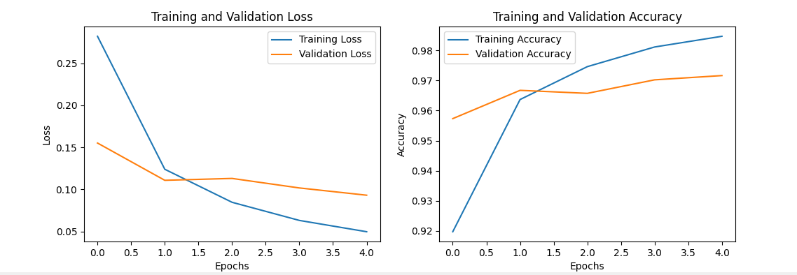
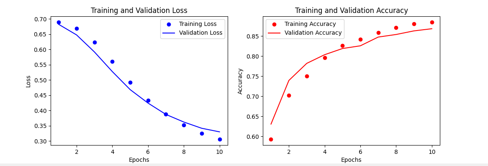

# Lab 1 – Tensors and First Neural Networks

Code: [`lab1.py`](lab1.py)

**Task 1 – Tensor operations.** Element-wise addition and multiplication, reshaping, slicing, concatenating, splitting and reductions on NumPy arrays.

**Task 2 – A first Keras model.** A small dense binary classifier (8 inputs → 16 ReLU → 1 sigmoid, 161 parameters) compiled with Adam and binary cross-entropy.

**Task 3 – Two classic benchmarks.**

| Dataset | Model | Result |
|---------|-------|--------|
| MNIST digits | Flatten → Dense 128 (ReLU) → Dense 10 (softmax), 5 epochs | ~97 % validation accuracy |
| IMDB reviews | Embedding (10k words, 16-d) → global average pooling → Dense 16 → sigmoid, 10 epochs | ~87 % validation accuracy |

| MNIST | IMDB |
|:-:|:-:|
|  |  |

The MNIST model starts to overfit after about two epochs: training loss keeps falling while validation loss levels off. The IMDB model is still improving after 10 epochs, and training and validation stay close together.
