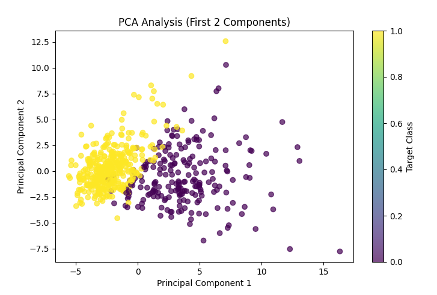
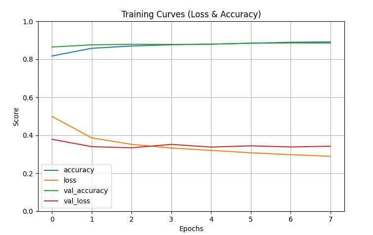
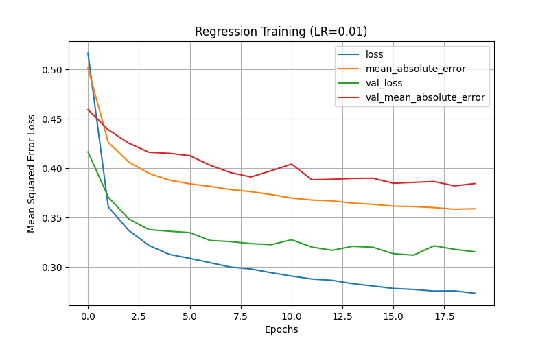
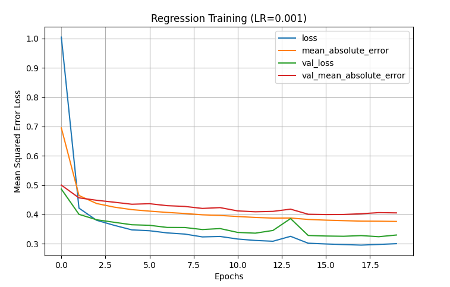

# Lab 2 – PCA and Multilayer Perceptrons

> The code for this lab isn't in the repository. This page summarises the results from the lab report.

## Principal component analysis

- Implemented PCA by hand (centering, covariance matrix, eigen-decomposition) on the Breast Cancer Wisconsin dataset (569 samples × 30 features). The projection matches scikit-learn's `PCA` exactly.
- **10 components** keep 95 % of the variance.
- A classifier on just **2 principal components** reached **99.1 %** accuracy, versus 97.4 % on all 30 original features.
- **Kernel PCA + MLP pipeline.** A grid search (3-fold CV, 32 candidates) over the kernel (linear, sigmoid, RBF), gamma, number of components and MLP size and regularization. The best pipeline used a sigmoid kernel with 5 components and a 50-unit MLP, reaching **96.5 %** test accuracy.

## Classification MLP

An MLP with two hidden layers (784 → 100 → 100 → 10, 89,610 parameters) trained on 28×28 grayscale images, with early stopping, reached **86.6 %** test accuracy.

## Regression MLP

An MLP regressor was first trained with LR = 0.01, then retrained with a smaller learning rate (0.001) and early stopping. The final model reached a test **MSE of 0.296** (MAE 0.383).

| LR = 0.01 | LR = 0.001 |
|:-:|:-:|
|  |  |
