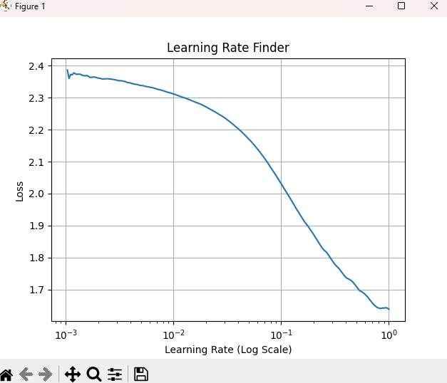

# Lab 3 – Training Deep Neural Networks

Code: [`lab3.py`](lab3.py). Training runs are logged to TensorBoard (`tensorboard --logdir my_logs`).

## Task 1 – Finding a good learning rate

A custom Keras callback raises the learning rate exponentially from 10⁻³ to 1 over 200 batches and records the loss. The loss keeps falling up to the top of the range, so **LR = 0.2** was chosen for SGD. The final 300-100 MLP used early stopping and reached **97.8 % test accuracy on MNIST**.

## Task 2 – Activations and initialization in a 100-layer network

A 100-layer dense network was trained on Fashion-MNIST (3 epochs, SGD). Each activation was paired with its matching initializer:

| Activation | Initializer | Validation loss | Validation accuracy |
|------------|-------------|-----------------|---------------------|
| Sigmoid | Glorot (default) | 2.303 | 9.8 % (does not learn) |
| ReLU | He | 0.992 | 59.0 % |
| ELU | He | 0.806 | 69.2 % |
| **SELU** | **LeCun** | **0.596** | **75.1 %** |

At this depth, sigmoid gradients vanish completely. SELU with LeCun initialization self-normalizes, so it trains best.

## Task 3 – Batch normalization and optimizers (CIFAR-10, 20 layers)

| Setup (Nadam, 20 epochs) | Final validation accuracy |
|-------|--------------------------|
| Without batch normalization | 47.1 % |
| With batch normalization | 51.7 % |

Batch normalization makes each epoch slower, but the model finishes about 5 points higher.

| Optimizer (15 epochs, no BN) | Validation accuracy |
|-----------|---------------------|
| **SGD + Momentum** | **49.7 %** |
| SGD + Nesterov | 48.5 % |
| AdaGrad | 47.4 % |
| Nadam | 43.1 % |
| RMSProp | 37.4 % |
| Adam | 35.5 % |

With these default learning rates and a deep plain MLP, momentum-based SGD generalized best. The adaptive methods were less stable. These results come from single short runs, so treat them as indicative rather than a fixed ranking.
