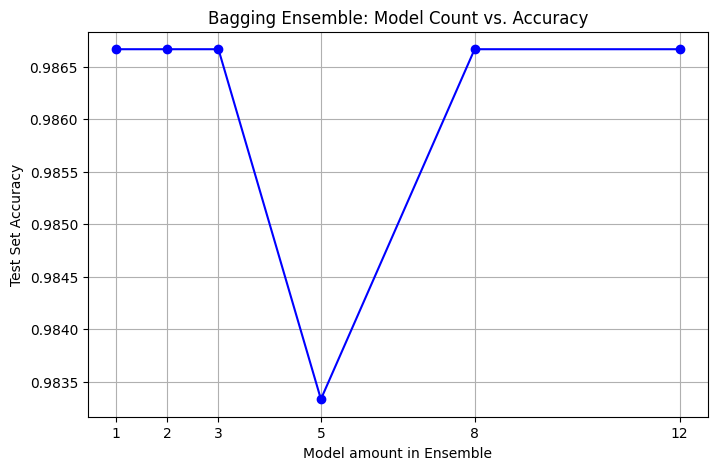
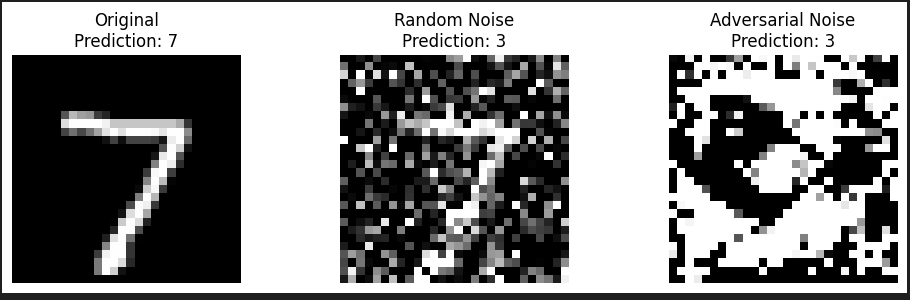

# Lab 4 – Regularization, Custom Models and Adversarial Examples

Notebook: [`lab4.ipynb`](lab4.ipynb)

## Task 1 – Regularized MNIST network

A 300-100 MLP with **L1 + L2 weight penalties**, a **max-norm constraint** and **dropout (0.2)**, trained with SGD for 10 epochs. It reached **93.1 %** test accuracy. The strong regularization keeps training and validation performance close together.

## Task 2 – Data augmentation with a custom layer (tf_flowers)

A small CNN on the 5-class flowers dataset (150×150). It uses Keras preprocessing layers (rescaling, random flip, random rotation) plus a **custom Keras layer** that applies random brightness only during training. It reached **65.4 %** validation accuracy after 10 epochs, still improving.

## Task 3 – Multi-output model (CIFAR-10)

A functional-API CNN with a shared trunk and **two heads**:
- `class_output`: 10-class CIFAR-10 classification (softmax)
- `binary_output`: animal vs vehicle (sigmoid)

| Head | Test accuracy |
|------|---------------|
| 10-class | 71.0 % |
| Animal / vehicle | 93.4 % |

## Task 4 – Bagging ensembles

1 to 12 small networks, each trained on a bootstrap sample of a synthetic 3-class blob dataset. Their averaged predictions scored 98.3–98.7 % for every ensemble size. The problem is simple enough that a single model is already near its ceiling, so bagging adds little here.

## Task 5 – Adversarial noise

A trained MNIST classifier is frozen. A trainable noise layer, fed a constant input of 1, learns a perturbation that **maximizes** the classifier's loss, using negative cross-entropy with L2 regularization. The learned noise flips the prediction for a "7" to "3". In this run, strong random noise (σ = 0.5) also caused a misclassification. A fairer comparison would use random noise of the same magnitude as the learned perturbation.

