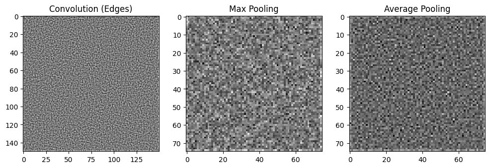

# Lab 5 – CNNs, ResNet-34 and Transfer Learning

Notebook: [`lab5.ipynb`](lab5.ipynb)

## Task 1 – Convolution and pooling with raw TensorFlow ops

A 3×3 Laplacian edge-detection kernel is applied with `tf.nn.conv2d`, followed by `max_pool2d` and `avg_pool2d`. This shows what a convolution layer and the two pooling types do to an image, and how pooling halves the resolution.

## Task 2 – CNN on Fashion-MNIST

Conv(32) → MaxPool → Conv(64) → Dense(64) → Softmax, trained for 5 epochs: **91.8 %** validation accuracy. That's a clear jump over the dense MLPs from earlier labs.

## Task 3 – ResNet-34 from scratch

Full **ResNet-34** built with the functional API: a 7×7 stem, then [3, 4, 6, 3] residual blocks with 64 / 128 / 256 / 512 filters. Blocks use batch normalization and 1×1 projection shortcuts wherever the shape changes. The model has 125 layers and **21.3 M parameters**.

## Task 4 – Transfer learning with Xception

An **Xception** base pre-trained on ImageNet, frozen, with a new global-average-pooling and softmax head, trained on tf_flowers (70 / 15 / 15 split, 299×299 inputs). After only 3 epochs it reached **88.4 % test accuracy**, far above the 65 % of the CNN trained from scratch in Lab 4.
