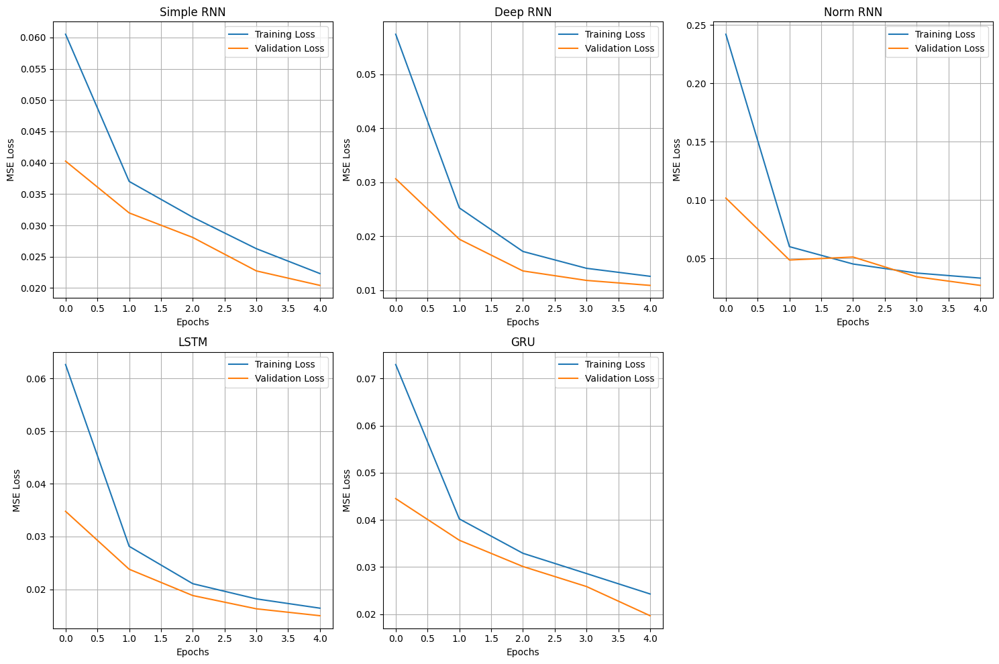
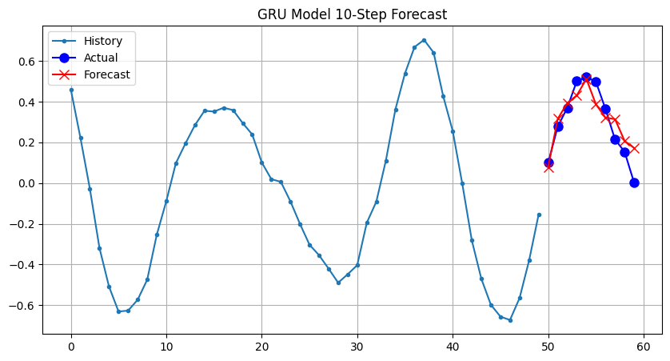

# Lab 6 – Recurrent Neural Networks

Notebook: [`lab6.ipynb`](lab6.ipynb)

## Task 1 – Forecasting a time series 10 steps ahead

Synthetic time series (two sine waves plus noise, 50 steps). Every model predicts the next 10 values at once and trains for 5 epochs.

| Model | Test MSE |
|-------|----------|
| SimpleRNN (1 layer) | 0.0209 |
| **Deep SimpleRNN (2 layers)** | **0.0110** |
| Deep RNN + batch/layer normalization | 0.0274 |
| LSTM (2 layers) | 0.0146 |
| GRU (2 layers) | 0.0196 |

Stacking a second recurrent layer halved the error. Adding batch normalization between recurrent layers made it worse, which matches the general advice that batch normalization suits RNNs poorly. After only 5 epochs, LSTM and GRU did not yet beat the deep SimpleRNN on this short, smooth series.

## Task 2 – Generating Bach chorales

The JSB Chorales dataset has four voices per time step. Chorales are cut into windows with `tf.data` (using ragged tensors, since chorale lengths differ) and notes are re-indexed with a separate rest token. A 2-layer LSTM (64 units) predicts the next chord, as one softmax per voice. It reached **~63 %** validation accuracy after 50 epochs.

To generate music, the model is seeded with 8 chords from a test chorale and extended one chord at a time. With greedy (argmax) sampling it quickly settles on a repeated chord. Sampling from the predicted distribution, with a temperature, would give more varied output.
